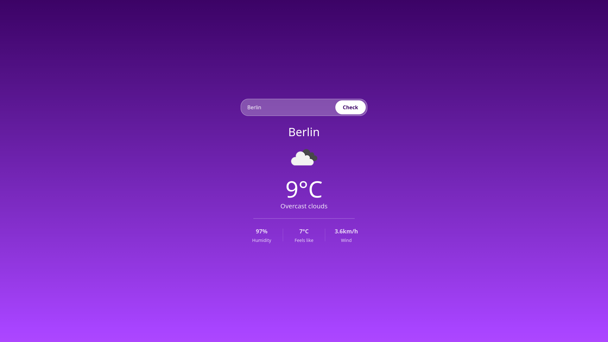

# Weather App

A simple pet project designed to practice working with REST APIs, asynchronous JavaScript, and UI design.

<p align="center">
  
</p>

## Tech Stack

- HTML5 / Tailwindcss
- JavaScript (Fetch API / Async-Await)
- OpenWeatherMap API

## Getting Started Locally

Follow these steps to run the project locally on your machine:

1. **Clone the repository:**
    ```bash
    git clone https:// github.com/pavlovoiat/weather-web-app.git
    ```
2. **Navigate to the project directory:**
    ```bash
    cd weather-web-app
    ```
3. **Set up your API Key:**
    - Sign up at [OpenWeatherMap](https://openweathermap.org) to get a free API Key.
    - Create a `config.js` file in the root folder.
    - Add your API Key:
        ```js
        export const API_KEY = "YOUR_API_KEY_HERE";
        ```
4. **Run the app:**
    - Open `index.html` using a local server (e.g., **Live Server** extension in VS Code / VSCodium).